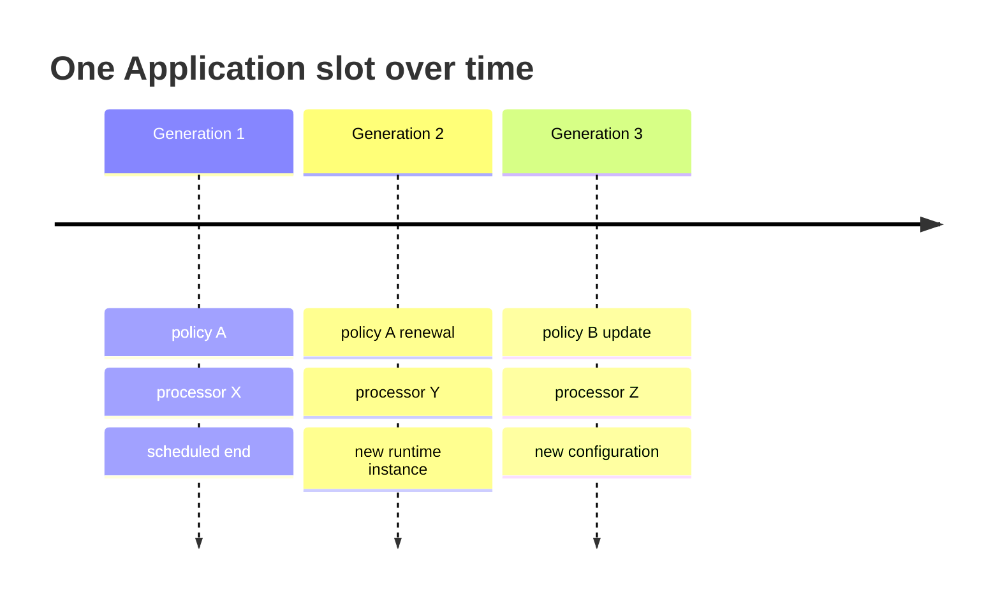

# Replacement custody and time-boxed execution

Liskov provides **replacement custody**: it safely holds the authority and
state needed to create bounded successor jobs as an Application renews,
updates, or recovers from a launch-stage failure.

It does not own a kill switch for the Acurast network.

## Why successors exist

An Acurast job has an immutable registration and scheduled end. The long-lived
Application therefore continues through generations:

Liskov records desired successor state separately from proof that it was
submitted, assigned, bootstrapped, and ready.

## Renewal and update

Renewal uses the same effective policy digest. An update selects a new policy,
artifact, or configuration generation. Fixed pre-end renewal can request
overlap; after-end renewal can avoid deliberate overlap. Neither guarantees
continuity because processor assignment and startup are market/network facts.

The supported v1 update behavior lets existing jobs run to scheduled end. That
preserves chain truth and can produce two live generations temporarily. Design
workloads with idempotent operations, leases, or external coordination when
duplicate activity matters.

## Pause and retirement

Pause stops new Liskov planning and spend admission. Existing registrations
continue. Retirement starts with pause, waits for all schedules and financial
tails to close, and then seals a receipt. No user or administrator can turn an
ambiguous nonzero gate into “complete.”

## Failure budgets

Launch retries are bounded by policy and surfaced through the Action Plan.
Runtime replace-after-failure is not enabled in the first public capability
set; v1 waits for scheduled end. This avoids hiding repeated spend or creating
unbounded replacement loops.

### Finalized chain failure (internal, release-gated)

Native chain-failure recovery is an accepted design, not a released customer
capability. Continuous recovery is the first delivery scope; its implementation
and release evidence must be verified before customers can rely on it.

A finalized Acurast execution failure is **placement evidence** for the exact
registration and processor. Chain failure alone does not prove an application
fault and creates no customer Hold. It is distinct from a signed runtime
failure, a deployment that never made signed contact, a bootstrap stall, and
silence after the runtime was Ready. Those signals retain their own evidence
and policy rules; serving silence alone does not trigger replacement.

The default **observe** behavior records evidence but buys nothing: it
authorizes no additional reserve or registration. A **canary** must bind the
exact Application identity, policy digest, stable job member, occurrence, and
failed deploy operation. An unmatched canary also buys nothing. Neither
observation nor an unmatched canary blocks ordinary renewal or existing
signed-failure and first-contact recovery. No global activation is promised.

When released and authorized for an eligible continuous job, the accepted
design recovers the current phase while its renewal runway and legal remaining
window allow it; otherwise it advances to the next phase. It reuses an already
progressing successor, so repeated evidence cannot buy another successor for
the same failed source. Existing intent, pacing, spend, placement, pause,
retirement, debug and application-failure Hold controls still apply. An exact
processor pin has no implicit fallback; excluding that processor can leave
Liskov waiting without another reserve.

#### Once and interval: a separate pending design

Once/interval recovery separately awaits implementation and release;
continuous delivery does not establish parity. The accepted design keeps the
same logical run and its original end. A replacement uses a fresh attempt and
only the original remaining run window, shortened further by any stricter
lifecycle bound. It never buys a new full-duration window or consumes another
manual Run authorization. Each admitted replacement still needs its own
reserve and passes the existing pacing and spend checks. Repeated evidence for
one failed attempt reuses its next attempt.

An expired or illegally short remainder admits no replacement. Interval
recovery keeps the original schedule grid and non-overlap rule; a competing
boundary is skipped, not shifted or caught up later. A failed attempt's
financial closeout does not by itself finish a run that still has recovering
members. This is a release-gated design, not a customer retry recipe.

### Never-contacted retained V5 jobs (release-gated)

The accepted retained V5 behavior permits one early replacement when a paid
registration makes no signed runtime contact after its chain-confirmed start,
assigned start allowance, and five more minutes. Liskov first requires a
verified contact elsewhere in its fleet within the previous two minutes. If
that ingest check is unproven, recovery waits without another reserve.

The replacement still uses the existing spend limits and placement checks.
An exact processor pin has no implicit fallback: when that processor is
excluded and no allowed alternative remains, Liskov waits without another
reserve. A late valid contact withdraws the trigger before a replacement is reserved.
The original job keeps its own scheduled window and financial closeout; an
inferred lack of contact does not prove that your code failed or globally
exclude the processor. When released, Activity and Coverage will identify
the reason and show when Liskov is waiting for contact ingest. This behavior
remains [release-gated](../reference/capabilities.md); do not rely on it for a
customer Application yet.

When investigating a silent registration, compare its scheduled start and
assigned start allowance before treating it as late. A submitted registration
alone does not prove that the workload started. Check Activity and Coverage
for the recovery reason, then verify output from the successor workload. A
fleet-ingest deferral means Liskov cannot yet prove contact collection is
healthy; repeatedly republishing the Application does not establish that proof.

The core distinction is simple: policy describes allowed intent; evidence
describes what actually happened.
